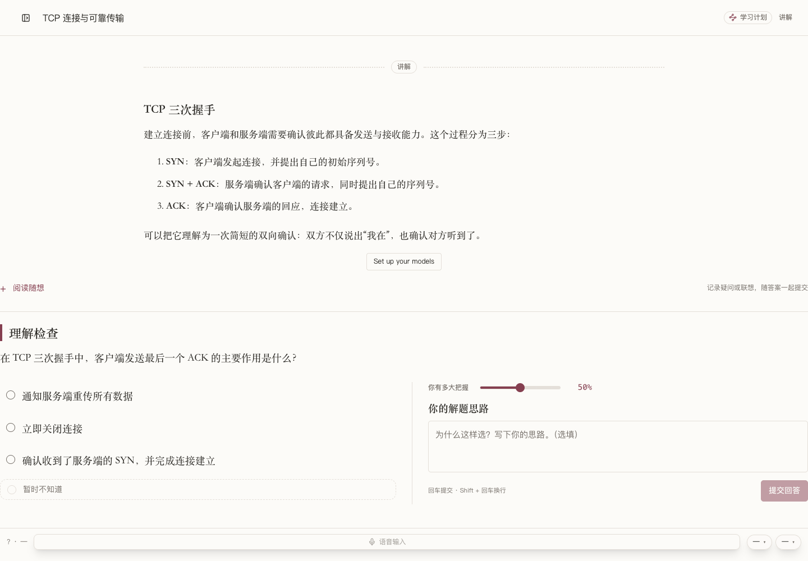
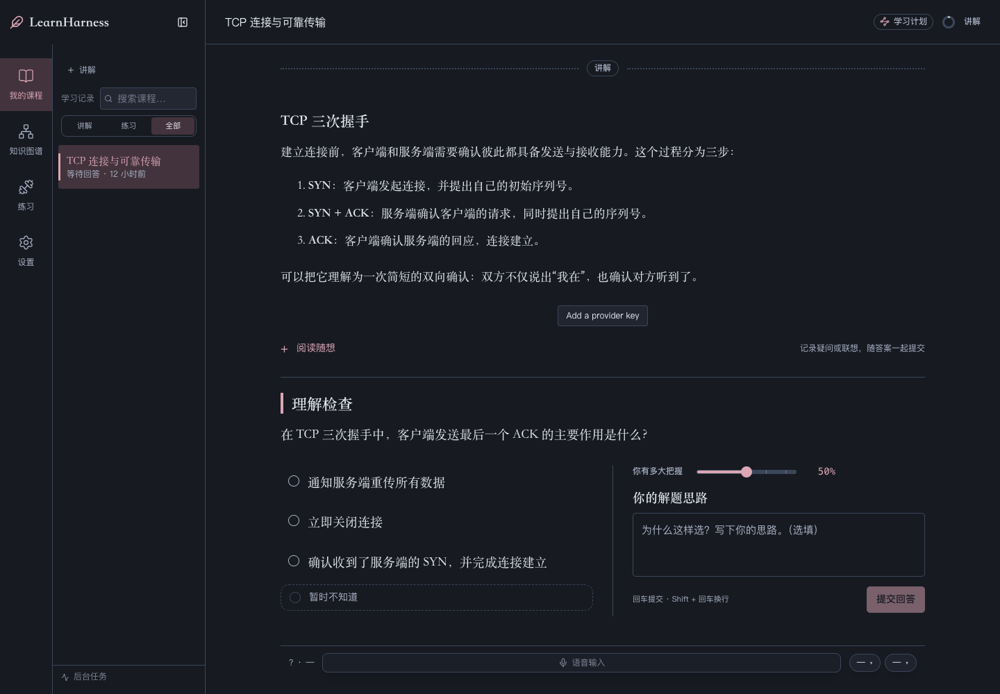
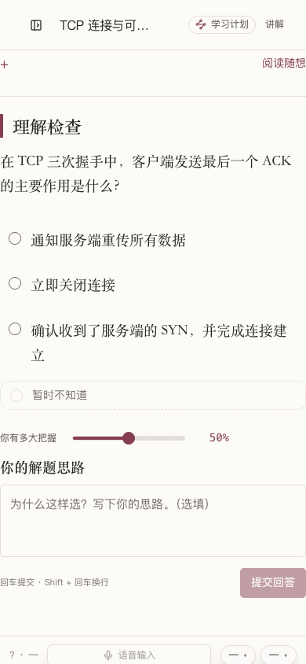
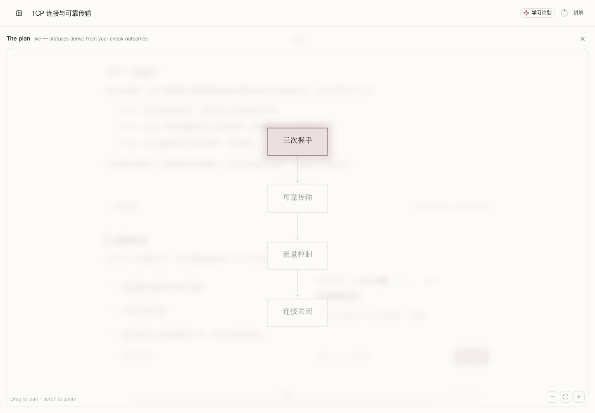

# LearnHarness 中文阅读自用版

这是基于 [LearnHarness](https://github.com/amosblomqvist/learnharness) `v0.5.0`（提交 `713377f366771e3e4730e6acd1bc290e0ebc6d6e`）整理的独立非官方衍生源码仓库，保留上游完整提交历史、原作者署名与 [AGPL-3.0-only](LICENSE) 许可证。上游原始说明见 [README.upstream.md](README.upstream.md)，修改与归属说明见 [NOTICE.md](NOTICE.md)。

本仓库用于公开可审阅的中文阅读排版与跨端作答实验源码：**不是官方发布版，不是完整的国际化（i18n）实现，也不是原生 iOS 应用或公网托管服务。**

## 界面截图

4张真实界面图截自本机已装LearnHarness Personal运行包，在隔离临时数据目录加载合成TCP课程，无个人课程/模型配置。并非本次公开源码重打包验收，手机图为桌面浏览器390px窄屏预览，非T3手机界面或iPhone实拍。


桌面浅色书刊主题（合成 TCP 示例），展示 CJK 字体、17px 正文、1.8 行距与题目末尾布局。


桌面深色书刊主题（合成 TCP 示例），降低夜间阅读对比度并保持一致的章节层级。


桌面浏览器手机宽度下的单栏阅读与作答界面预览（合成 TCP 示例，非真机实拍）。


合成 TCP 示例课程的章节计划与学习进度概览界面。

## 定位与改动概览

本版保留上游核心教学、问答判分、练习与知识图谱机制，仅围绕个人中文学习习惯做了以下调整：

- **中文界面文案（内联替换）**：常用学习主流程已改为中文，但采用直接替换组件文案的方式实现，没有语言切换开关，部分高级设置与菜单仍保留英文。
- **书刊式阅读外观**：提供浅色纸面与深色两套配色，调整中文字体回退栈、正文字号（17px）、行距（1.8）与阅读栏宽。这类视觉取向属于个人偏好，不代表上游设计方向。
- **桌面端题目卡片布局**：待答题目挂载在教学正文末尾而非悬浮遮挡；宽屏下选项与解题思路可左右并排，窄屏自动改为纵向堆叠，桌面端完整保留“阅读随想”与“解题思路”输入。
- **实验性本地 ACP 转接**：在桌面包内通过当前系统用户私有的本地 Unix socket 暴露受限课程接口，供支持 ACP 表单（form elicitation）的客户端（如 T3 Code）连接同一套运行中的课程后端。
- **独立应用标识与目录**：打包名称为 `LearnHarness Personal`（`local.learnharness.personal`），禁用官方自动更新，避免覆盖本地定制版本。仓库仅提供源码，不分发签名安装包。

更多自用版边界说明见 [docs/personal-edition.md](docs/personal-edition.md)。

## 数据隔离与跨端共享

### 1. Personal 与上游原版完全隔离

在 macOS 上，两个版本使用各自独立的数据目录，**不会自动迁移或双向同步**：

- 上游原版：`~/Library/Application Support/LearnHarness/data`
- 本仓库 Personal 版：`~/Library/Application Support/LearnHarness Personal/data`

即便手动复制过目录，也只是一次性快照。**严禁让两个后端进程同时读写同一个数据目录。** 本仓库不包含任何个人课程数据、学习记录、模型 API 密钥、预设路由或私人截图。

### 2. 客户端（如 T3）与 Personal 共享同一运行中后端

通过 ACP 接入时，手机或桌面客户端直接读写正在运行的 `LearnHarness Personal` 课程后端，不另建数据库：

```text
支持表单的远程客户端（如手机端 T3）
  → 客户端自身的已认证远程连接
  → Mac 上的 ACP 转接器（acp/bridge.mjs）
  → Personal 本地 Unix socket（仅当前系统用户可读写）
  → 同一套 Personal 课程后端 → 用户自行配置的模型服务
```

使用前提与客观限制：

- **运行前提**：Mac 必须保持开机、联网且不休眠，`LearnHarness Personal` 与客户端宿主服务需同时运行；客户端的远程登录、隧道与设备鉴权需由用户自行配置，切勿将本地后端直接裸露到公网。
- **界面形态**：手机端看到的是客户端渲染的纯文本与问答表单，**本项目不提供原生 iOS 应用，客户端也不会呈现桌面端的书刊排版界面**。知识图谱、资料附件上传与高级设置仍在桌面端操作。
- **手机端作答偏好**：提交答案后会自动跟进老师讲解并在有下一题时连续弹出表单；表单省略可选的“解题思路/阅读随想”；单选题/多选题未填把握程度时默认按 `80` 提交，选择“暂时不知道”时不记录把握程度。`80` 仅为减少手机端操作步骤的个人默认值，**不代表真实主观置信度数据**。
- **模型配置规则**：仓库没有内置指定模型线路，需在桌面端自行配置兼容服务。每门已创建的课程会保留各自绑定的模型设置，修改全局默认模型只影响新建课程。
- **已知同步与显示边界**：客户端会话标题与桌面课程标题未做双向同步；空闲后可用 `/refresh` 重新拉取记录；客户端内的数学公式渲染与工具原始 JSON 展示取决于客户端自身实现，本项目未修改客户端渲染器；ACP 流式响应已修复跨数据包 UTF-8 多字节中文/emoji 解码，但历史记录里已经落盘的旧乱码不会自动改写。

详细配置步骤见 [acp/README.md](acp/README.md)。

## 开发与本地构建

主要开发与自用环境为 macOS Apple Silicon，Node.js 版本建议与 `.github/workflows/ci.yml` 一致（Node 26）。

启动本地桌面开发模式（注意：纯 `npm run dev` 网页模式不会启动打包壳内的 ACP socket 服务）：

```sh
git clone https://github.com/wanghao-SunSky/learnharness-zh.git
cd learnharness-zh
npm ci
npm run desktop:dev
```

构建 macOS ARM64 本地自用包（输出到 `dist-personal/`，清理脚本仅清理 `dist-personal` 与 `.next/standalone`）：

```sh
npm run desktop:personal
codesign --force --deep --sign - "dist-personal/mac-arm64/LearnHarness Personal.app"
```

上述命令仅执行本地 ad-hoc 自签名，不包含 Apple 开发者签名或公证；系统依赖与打包前置条件可参考上游文档 [docs/desktop-release.md](docs/desktop-release.md)。Windows 与 Linux 下的中文字体回退及打包未在本版验证。

## 验证范围

已核验的公开源码（提交 `e5900f6`）已在独立检出目录完成以下本地检查：

- `npm run typecheck` 通过；
- 9 个定向中文 UI 与设置测试文件共 **163** 项测试通过；
- `acp` 重新构建及 **12** 项转接器单元/集成测试（基于合成夹具与模拟响应）通过。

尚未重跑完整上游测试套件，也未在本次公开检出上重做全新生产打包、Windows/Linux 排版测试或真实 iPhone 端到端验收；远程 CI（[Actions Run #43020448357](https://github.com/wanghao-SunSky/learnharness-zh/actions/runs/43020448357)）已在源码提交 `e5900f6` 上通过（仅对应 `e5900f6` 的类型与定向测试，不含完整上游测试套件与新生产打包验收）。完整命令与边界见 [docs/validation.md](docs/validation.md)。

## 上游协作与问题反馈

- **与上游的关系**：本仓库只作为个人实践参考公开，不请求上游合并整包改造，也不打算另起一套竞争性的 i18n 框架。计划先向上游沟通是否需要保持默认外观不变的小范围 CJK 字体/阅读排版改进；中文界面翻译后续对齐上游既有国际化讨论（如 [#407](https://github.com/amosblomqvist/learnharness/issues/407)、[#457](https://github.com/amosblomqvist/learnharness/pull/457)），书刊主题、ACP 转接与默认置信度保持在个人分支独立维护。拟提交的中文说明草稿见 [docs/upstream-proposal.md](docs/upstream-proposal.md)。
- **反馈渠道**：凡属本仓库中文界面、Personal 打包或 ACP 转接的问题，请提交至[本仓库 Issues](https://github.com/wanghao-SunSky/learnharness-zh/issues)，不要把衍生版特有的问题报给上游。本仓库不承诺跟随上游每次更新实时同步。

## English Summary

`learnharness-zh` is an independent, unofficial source fork of [LearnHarness](https://github.com/amosblomqvist/learnharness) based on `v0.5.0` (`713377f366771e3e4730e6acd1bc290e0ebc6d6e`), published under the original **AGPL-3.0-only** license with full commit history and authorship preserved.

- **What it changes**: inline Chinese UI copy (partial, with no language switcher and some English menus remaining), personal book-style light/dark themes and CJK typography, an end-of-lesson responsive exercise card layout, a separate `LearnHarness Personal` app identity/data directory, and an experimental owner-only local Unix-socket ACP adapter for answering lessons from form-capable remote clients (such as T3 Code) against the same running Mac backend.
- **What it is not**: not an official release, not a complete i18n framework, not a native iOS app, and not a hosted service. No personal study data, API keys, provider routes, or private screenshots are included.
- **Upstream plan**: rather than proposing a full-fork merge or a parallel i18n design, any upstream contribution will start by asking maintainers whether small, default-preserving CJK typography improvements are welcome, and align future Chinese translations with upstream i18n direction ([#407](https://github.com/amosblomqvist/learnharness/issues/407) / [#457](https://github.com/amosblomqvist/learnharness/pull/457)), keeping themes, ACP, and personal quiz defaults separate.
