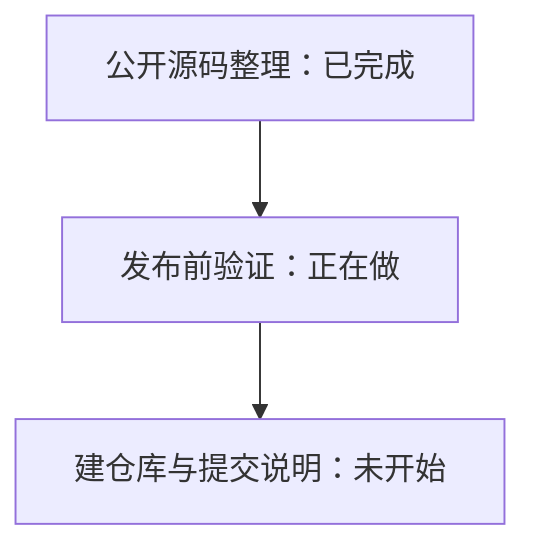
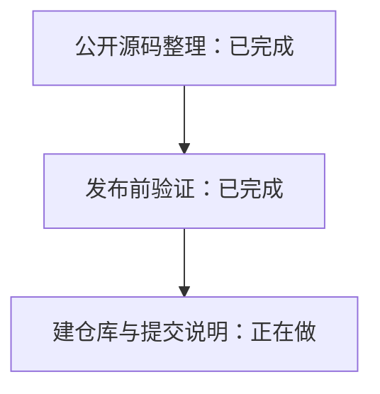

# Publication progress

## 2026-11-11 — 公开源码整理完成

独立保留上游历史并整理中文界面、个人打包和 ACP 源码。文档区分原版/Personal 数据目录与客户端共享后端，明确不是完整 i18n 或原生 iOS 应用。发布副本排除私有课程、配置、截图和部署日志，测试脚本改用显式环境变量传入临时课编号；不改正在使用的自用版目录。

静态路径检查和 diff 空白检查通过。上游已有国际化提案 #407，将在讨论中引用。下一步类型检查和相关回归，之后创建公开仓库并提交范围明确的上游说明；目前尚未发布。

## 2026-11-11 — 发布前验证完成

在独立发布目录重新安装依赖，163 项中文界面/设置检查、12 项 ACP 检查通过。类型检查发现转接器两个隐式 any 回调错误，已补类型并复查通过；只修正公开副本，不改变运行中的自用环境。文件清单、个人路径/课程编号/线路/凭据模式检查和 diff 空白检查通过。

未重跑完整上游套件、桌面打包或 iPhone 端到端验证，文档明确标注。已查到上游 #407 国际化提案及评论；公开工作看板读取缺少 read:project 权限，没有扩大账号权限，也不声称已查完整看板。下一步创建公开仓库并提交中文排版实践说明，引用 #407，避免重复提出基础国际化方案。

