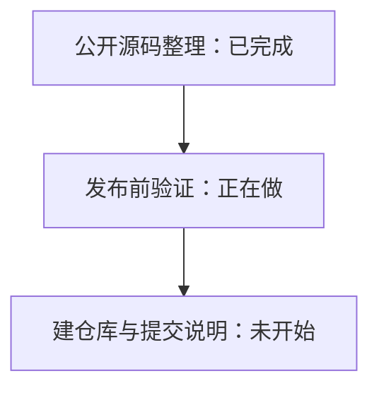
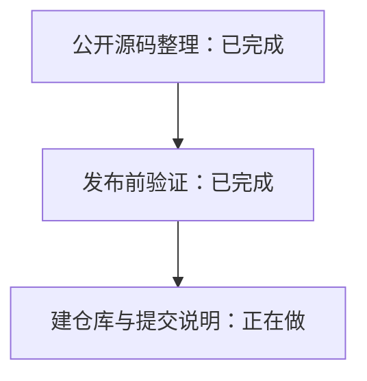
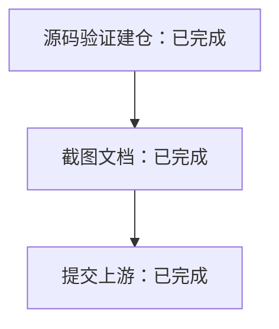
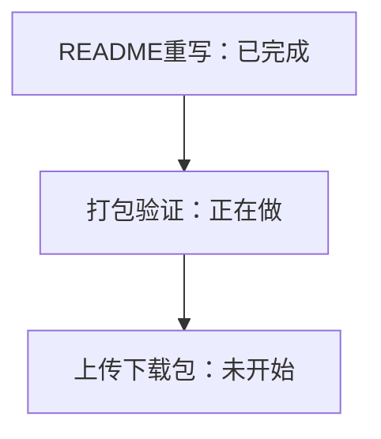

# Publication progress

## 2026-11-11 — 公开源码整理完成

独立保留上游历史并整理中文界面、个人打包和 ACP 源码。文档区分原版/Personal 数据目录与客户端共享后端，明确不是完整 i18n 或原生 iOS 应用。发布副本排除私有课程、配置、截图和部署日志，测试脚本改用显式环境变量传入临时课编号；不改正在使用的自用版目录。

静态路径检查和 diff 空白检查通过。上游已有国际化提案 #407，将在讨论中引用。下一步类型检查和相关回归，之后创建公开仓库并提交范围明确的上游说明；目前尚未发布。

## 2026-11-11 — 发布前验证完成

在独立发布目录重新安装依赖，163 项中文界面/设置检查、12 项 ACP 检查通过。类型检查发现转接器两个隐式 any 回调错误，已补类型并复查通过；只修正公开副本，不改变运行中的自用环境。文件清单、个人路径/课程编号/线路/凭据模式检查和 diff 空白检查通过。

未重跑完整上游套件、桌面打包或 iPhone 端到端验证，文档明确标注。已查到上游 #407 国际化提案及评论；公开工作看板读取缺少 read:project 权限，没有扩大账号权限，也不声称已查完整看板。下一步创建公开仓库并提交中文排版实践说明，引用 #407，避免重复提出基础国际化方案。

## 2026-11-11 — 公开仓验证与截图文档整理

- **这一阶段做了什么**：把自用的中文阅读实验版整理成独立公开仓库，跑完了源码类型检查、163 项界面设置测试、12 项本地连接模拟测试和隐私排查，目前正在补齐说明文档与示例截图。
- **为什么这样做**：独立建仓并隔离数据目录更稳妥清晰。
- **遇到了什么问题、哪里还没把握**：源码提交 `e5900f6` 的定向检查与远程自动检查均已通过，公开副本已排除私人路径与密钥；但尚未跑全套上游测试、未重新打生产安装包，缺少 Windows/Linux 视觉核对与真 iPhone 端到端实测，手机截图只是桌面浏览器调窄窗口的合成示例预览。
- **下一步打算做什么**：完成四张截图与仓库文档核对，确认无误后再准备向上游发帖交流（目前尚未发帖）。

## 2026-11-11 — 文档截图与上游说明发布完成

- **做了什么**：保留上游历史与 AGPL 协议，补齐中文 `README`、4 张合成演示图及上游中文说明帖。
- **为什么这样做**：分离为自用实验仓而非提整包改动（PR），避免把个人定制塞给上游添负担。
- **问题与验证缺口**：源码 `e5900f6` 已过类型检查（`typecheck`）及 163 项界面（UI）、12 项通信（ACP）测试；未新打包、缺真 iPhone 全流程实测，手机图仅为桌面窄屏预览。
- **下一步**：等待维护者反馈，无接受承诺。

上游讨论：https://github.com/amosblomqvist/learnharness/issues/672

## 2026-11-11 — 简化介绍与提供下载包

- **做了什么**：重写并精简首页说明，只保留中文适配、界面美化、ACP 接入三件事和一张主图，把直接下载指引放在第一屏。
- **为什么这样做**：之前截图太多要滑很久，而且大家更想下载现成软件直接用，省去自己配环境编译的麻烦，所以改为下载优先、编译命令折叠收起。
- **哪里待确认**：说明文稿已定稿，实际压缩包表现、校验文件与最终下载链接由主 Agent 执行打包检查后确认。
- **下一步做什么**：构建并核验本机安装包，上传发布后回填真实下载地址。

